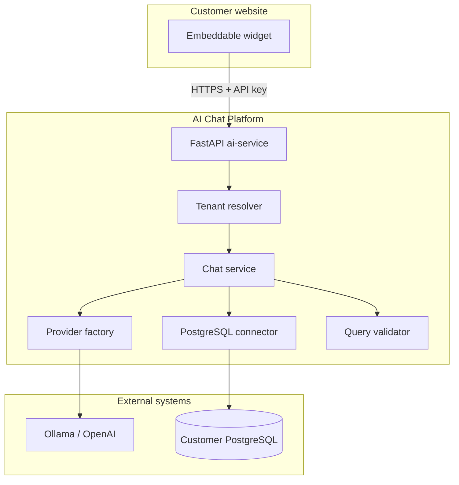
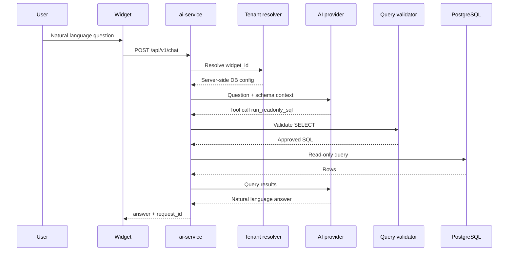

# Architecture

## Overview

The platform separates **customer-facing UI** (embeddable widget), **AI orchestration** (FastAPI service), and **customer data** (PostgreSQL accessed with read-only credentials).

## Request flow

## Design principles

- **Never trust the browser** for database URLs or tenant secrets.
- **Validate SQL in application code** before execution.
- **Pluggable AI providers** via a shared interface and factory.
- **Pluggable database connectors** starting with PostgreSQL.
